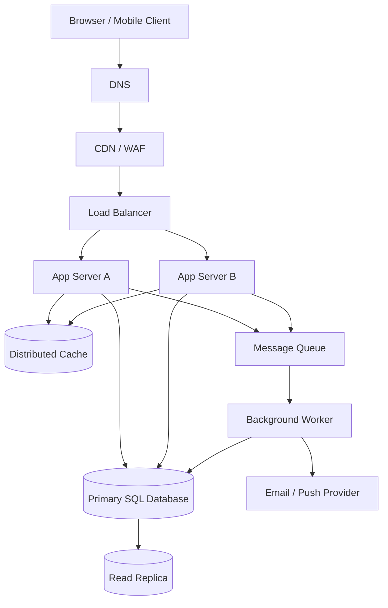

# QuickNotes System Architecture

## 1. Requirements

### Functional requirements
- Register and authenticate users securely.
- Create, read, update, delete, search, and tag notes.
- Ensure users can access only resources they own or that are explicitly shared.
- Paginate lists and support clients on desktop and mobile.
- Return consistent validation and error responses.
- Support account recovery and user-controlled account deletion.

### Non-functional requirements
- Availability target: 99.9% monthly as an initial service objective.
- Performance target: p95 read latency below 300 ms under normal load, excluding client network latency.
- Security: TLS, hashed passwords, access controls, rate limiting, input validation and audit logging.
- Durability: automated backups and tested point-in-time recovery.
- Scalability: stateless application servers and horizontal scale-out.
- Observability: centralized logs, metrics, traces, health checks and actionable alerts.
- Maintainability: versioned API, automated tests, CI/CD and documented schema migrations.

## 2. Capacity estimate for 1 million users

These are planning assumptions, not measured traffic. Assume 1,000,000 registered users, 10% daily active users (100,000), each active user makes 50 reads and 5 writes per day, and traffic is averaged across 24 hours.

- Reads/day = 100,000 × 50 = 5,000,000; average reads/sec = 5,000,000 / 86,400 ≈ **58 reads/sec**.
- Writes/day = 100,000 × 5 = 500,000; average writes/sec = 500,000 / 86,400 ≈ **5.8 writes/sec**.
- Assume each stored note averages 2 KB including row/index overhead and each active user creates 5 notes/day. New data = 100,000 × 5 × 2 KB = about 1 GB/day, or approximately **365 GB/year** before replication, backups, indexes, and growth. If instead all 1 million users create 5 notes/day, the estimate becomes about 3.65 TB/year.
- Production systems must plan for peaks; a 10× peak factor gives approximately 580 reads/sec and 58 writes/sec under the 10% daily-active assumption.

Revisit these estimates with real telemetry, note-size distributions, retention policies and actual active-user rates.

## 3. Architecture diagram

## 4. Component responsibilities

- **Client:** presents the interface, performs basic validation and communicates with the API over HTTPS.
- **DNS:** resolves the public service name to the edge entry point and supports controlled routing changes.
- **CDN/WAF:** serves cacheable static assets near users and filters common malicious traffic before it reaches the application.
- **Load balancer:** health-checks app instances and distributes incoming requests across healthy servers.
- **App Server A and B:** run the stateless API so capacity can grow horizontally and one instance can fail without stopping all requests.
- **Distributed cache:** reduces repeated database reads for suitable data; cache entries require expiry and invalidation rules.
- **Primary SQL database:** is the authoritative store for writes and transactional consistency.
- **Read replica:** serves eligible read traffic and reduces load on the primary, while accepting that replication lag can make recent writes temporarily invisible.
- **Message queue:** buffers asynchronous work and absorbs bursts without forcing the user request to wait for slow side effects.
- **Background worker:** processes queued notifications, cleanup and other retryable jobs independently of API request handling.
- **Email/push provider:** delivers notifications outside the core request path.

## 5. Request flows

### GET `/v1/notes`

1. The client sends an HTTPS request with its access token and optional pagination/search parameters.
2. DNS resolves the API hostname; the CDN/WAF applies edge protections and forwards dynamic API traffic.
3. The load balancer selects a healthy application server.
4. The server validates the token, verifies user scope, and validates query parameters.
5. The server checks the cache for a suitable user-scoped result; cache keys must include user and query parameters.
6. On a cache miss, the app queries the read replica when eventual consistency is acceptable, or the primary when fresh data is required.
7. The server returns a paginated JSON response and safe cache headers; the cache may store eligible results for a short TTL.
8. Metrics and structured logs record latency, status and request ID without logging secrets or note contents unnecessarily.

### POST `/v1/notes`

1. The client sends a JSON payload and bearer token over HTTPS.
2. DNS, edge protections and the load balancer route the request to a healthy app server.
3. The server authenticates the user, validates title/body/tag IDs and enforces ownership rules.
4. The app inserts the note into the primary database inside a transaction and commits it.
5. The app invalidates or versions relevant cached note-list entries so old data is not served for too long.
6. The API returns `201 Created`, the created note representation and a `Location` header.
7. If post-create side effects are needed, the app writes an event to the queue (preferably using a transactional outbox) and returns without waiting for email or push delivery.
8. A worker processes the event with retries and idempotency safeguards; failures are visible through metrics and a dead-letter queue.

## 6. Trade-offs and failure handling

1. **Cache speed vs freshness:** caching lowers database load and latency, but can serve stale data. Use short TTLs, explicit invalidation/versioned keys, and bypass cache for operations requiring read-after-write consistency.
2. **Read replica throughput vs replication lag:** replicas spread reads, but recently written notes may not appear immediately. Route critical read-after-write requests to the primary and monitor replication lag.
3. **Synchronous vs asynchronous side effects:** queues improve response times and absorb bursts, but add operational complexity and eventual delivery. Use retries with backoff, idempotent workers, dead-letter queues and queue-depth alerts.
4. **Availability vs strong consistency:** the primary database is the write authority, preserving transactional correctness, but a primary outage can interrupt writes until failover completes. Use managed database HA, automated failover, tested backups and point-in-time recovery.

## 7. Avoiding single points of failure

Run at least two app servers across separate availability zones behind a health-checking load balancer; use redundant DNS and a multi-zone CDN/WAF; deploy the cache in a replicated/managed configuration; configure database replication plus automated primary failover; and run multiple queue consumers with durable replicated queue storage. Monitor dependencies, test failover regularly, and maintain off-site backups. A read replica alone is not a complete failover plan unless promotion, client reconnection and recovery procedures are tested.
